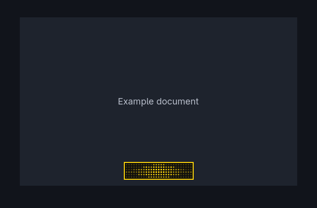
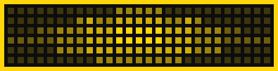
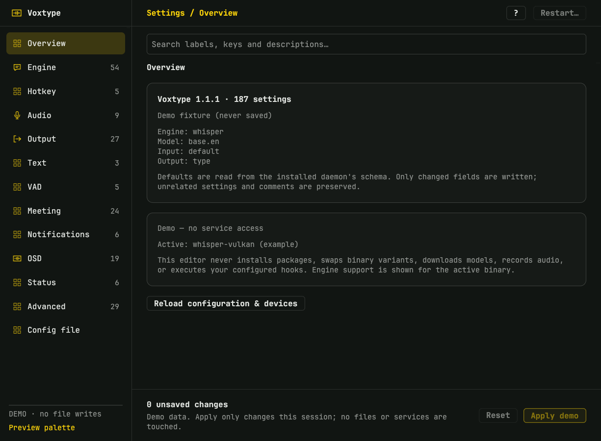

# Voxtype UI



Centered silhouette rendered at 3× for inspection (example accent):



A custom Voxtype recording overlay and a complete graphical settings editor
on Omarchy/Hyprland.

## Status

The approved indicator can run as Voxtype's live OSD through its official
Quickshell frontend. See [installation and rollback](docs/install.md). It follows
real daemon state/audio without changing transcription or output handling.
The separate **Rune settings editor** is working: it reads the installed
Voxtype schema and hardware support, edits every setting in the installed schema (187 in Voxtype
1.1.1) plus the full TOML document, validates and backs up before an explicit
Apply, and keeps daemon restart as a separate confirmation.

To preview without installing:

```sh
bin/preview --demo  # Try the focus-following overlay without recording.
bin/preview         # Follow the existing daemon during real dictation.
```

Run in a terminal and press **Ctrl+C** to stop. Neither command replaces the
current OSD or installs/autostarts anything. The live integration is an explicit,
separate installation step. The screenshots use fake content.
The dots and border follow Omarchy's theme accent dynamically. The fill remains
black; the screenshots use an example accent rather than your current theme.

### Settings preview

```sh
bin/settings          # Live editor for ~/.config/voxtype/config.toml.
bin/settings --demo   # Synthetic data; Apply never writes or restarts.
bin/settings-test     # Tests and headless gallery in build/settings/.
```



The editor follows `voxtype config schema --json`: engine, hotkey, audio,
output, text, VAD, meeting, notifications, OSD, status and advanced controls,
with discovered models, ALSA devices, engines and OSD styles. The Config file
page covers replacements, profiles, modifier maps, driver arrays and future keys.
Apply validates the whole file, writes a private backup, preserves mode and
atomically replaces the configuration; restart requires a separate confirmation
and an idle daemon. Styling follows Strata's Omarchy mode: 13px JetBrains Mono,
compact chrome and flat controls. See [settings/README.md](settings/README.md).

## Agreed first version

- A square-corner black indicator sized around its 27 × 6 square-dot grid, rather
  than squeezing dots into a fixed box. At 125% display scaling it is 136 × 36
  logical pixels: identical 4 × 4 physical-pixel dots and 2px gaps on both axes.
- The border matches Hyprland's current focused-window border thickness; dots
  and border follow Omarchy's theme accent. Updates apply without restarting.
- Physical-pixel-aligned squares and uniform grid spacing, positioned about twelve
  logical pixels inside the focused window's bottom center. A native-pixel Canvas
  buffer uses the actual window scale (which can differ from the screen scale).
  A black gap also separates every dot from the frame.
- Exact centered taper at rest/reference; bounded, symmetric speech activity at
  12.5 fps and a stepped processing sweep. No outlines, glow, blur, or gradients.
- Follow whichever window is currently focused, including during transcription.
- Never activate a window, restore focus, or change Voxtype's output handling.
- Install through Voxtype's existing OSD supervisor after testing the preview.
- Hide when processing ends; do not imply successful insertion from `idle` alone.

## What we want

### Window-aware recording overlay

- A compact voice-reactive dot matrix identifies the active window where the
  dictated text will normally be inserted.
- Keep the overlay click-through and non-focus-stealing.
- States: amplitude-reactive centered stacks while recording; a stepped pulse
  sweeping the fixed silhouette during transcription; hidden after processing.
- Chosen visual direction: theme-accent square dots, black #0D0D0D fill and an
  inside border matching the window highlight. Dots use only 20/40/60/80/100%
  opacity; square corners stay independent of desktop rounding.
- Follow moving/resizing, maximized windows and multiple monitors. The indicator
  stays square regardless of desktop rounding and hides on undersized windows.

### Graphical configuration editor

- The existing Voxtype TUI feels too barebones to the user.
- Design a friendlier way to inspect and edit Voxtype settings.
- Rune/rune-kit editor covering every installed schema setting (187 in 1.1.1) plus full TOML.
- Discover models, ALSA devices, engines, OSD styles and binary variants.
- Preserve comments and unrelated settings; validate the complete file and back
  up atomically before writing. Keep service restarts explicit and idle-gated.

## Important focus/delivery distinction

The existing typing-based output generally goes to the focused application when
transcription finishes. A window highlight alone does not lock delivery to that
window or identify the exact text field.

Following focus is explicitly chosen for the first version. The overlay does
not lock delivery or identify the exact text field. Focus changes during the
actual typing operation can still affect where text lands.

## Current local setup

- Voxtype 1.1.1, running as the user service `voxtype.service`.
- Model: Mesolitica Malaysian Whisper Small v2.
- Model file: `~/.local/share/voxtype/models/ggml-malaysian-whisper-small-v2.bin`.
- English fallback: `ggml-base.en.bin`.
- `language = ["en", "ms"]`, `translate = false`, output mode `type`.
- Official Vulkan variant selected: `/usr/bin/voxtype` points to
  `/usr/lib/voxtype/voxtype-vulkan`.
- Temporary Vulkan systemd override was removed; service uses
  `/usr/bin/voxtype daemon` normally.
- Recording overlay uses this UI via `frontend = "quickshell"` and the official
  `voxtype-osd-quickshell` launcher. The stock GTK4 OSD remains available for
  rollback; no package-owned files are modified.
- Installed CLI exposes Quickshell OSD styles/recipes and custom QML support;
  investigate reuse before building a separate overlay.
- Keep the existing Small v2/Vulkan dictation working while developing UI.

Re-check these details before implementation; they may change between sessions.

## Useful locations

- `~/.config/voxtype/config.toml` — user configuration.
- `~/.config/systemd/user/voxtype.service` — user service.
- `~/.config/hypr/bindings.lua` — personal dictation bindings.
- `~/Work/voxtype-malaysian-whisper-small-v2/` — existing conversion toolkit;
  leave this repository in place.

## Prototype architecture

- `overlay/` — standalone Quickshell layer-shell overlay. Reuses the packaged
  Voxtype state reader and audio bridge; Hyprland supplies focused-window geometry.
- `bin/preview` — foreground runner; `--demo` uses synthetic audio without recording.
- `integration/50-voxtype-ui.conf` — user-service environment override selecting
  the stable installed QML, without replacing the daemon command.
- `bin/test` — geometry/QML tests plus native framebuffer tests at five display
  scales. Compiles the small test helper using C++, pkg-config and Qt 6 headers.
- `bin/test-compositor-pixels` — optional real-desktop check using a tiny fake,
  click-through indicator. Captures only that opaque test box with grim and checks
  every composited pixel; requires Hyprland, Quickshell and ImageMagick.
- `tests/` — fake-data rendering fixture, exact dot/pixel checks, speech simulation
  invariants, and geometry edge cases.
- `settings/` — Rust/Rune working settings editor with schema, discovery,
  comment-preserving TOML patches, validation, backups and explicit restart.
- `bin/settings`, `bin/settings-build`, `bin/settings-test` — launch (live or
  `--demo`), build and verify the editor.

See [docs/prototype.md](docs/prototype.md) for usage and current limitations.

## Next steps

1. Read this brief and applicable Omarchy skills before changing desktop config
   or selecting a desktop-app stack.
2. Test live dictation in a disposable field after installation.
3. Verify moving/resizing windows and multiple monitors on the real desktop.
4. Review the working Rune editor on an unlocked desktop, including native
   fractional scaling, then keep it aligned with future Voxtype schema versions.
5. Keep updates, rollback and any service restart explicit.
