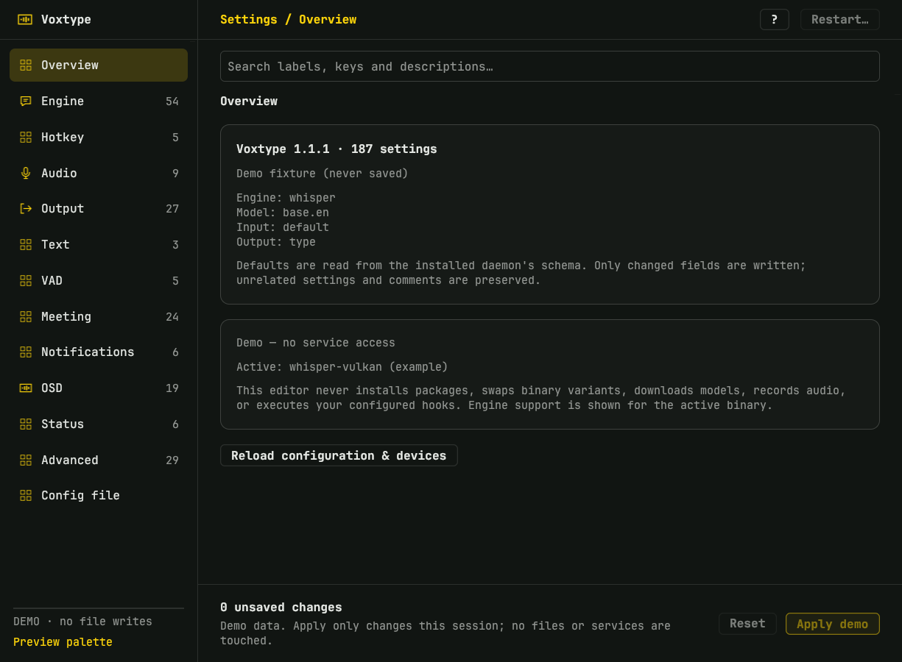
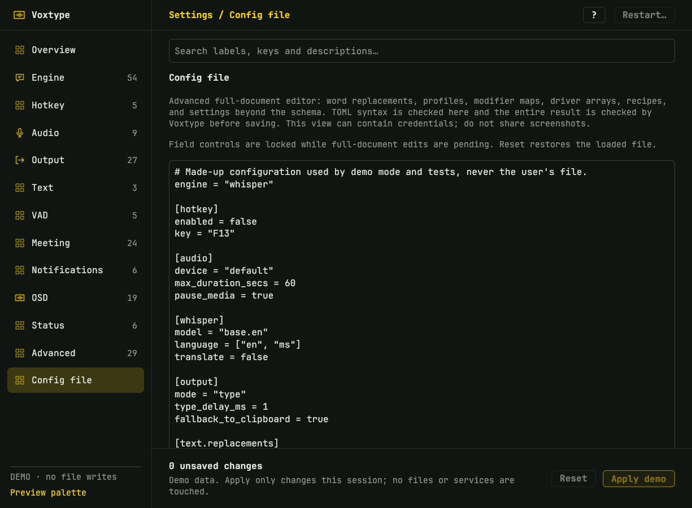
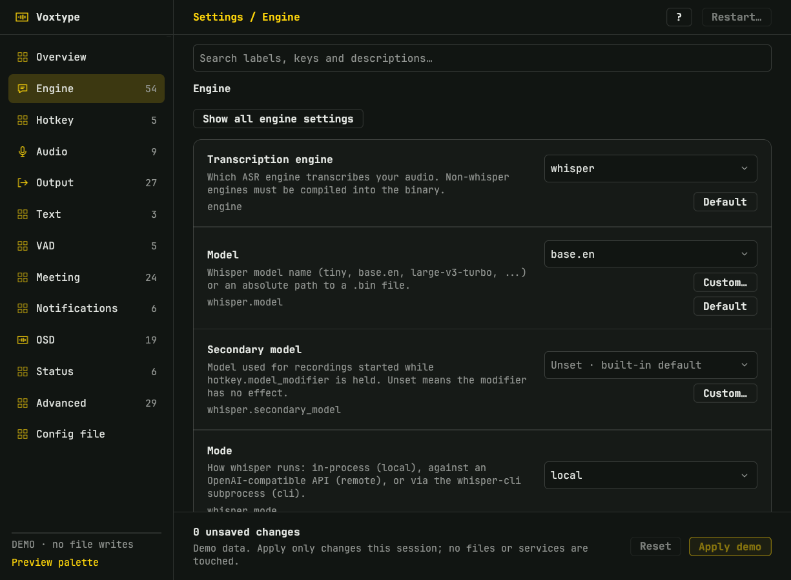

# Voxtype Settings



A native Rune settings app for Voxtype on Omarchy/Hyprland. It is a **working
editor**: it reads the installed Voxtype schema, discovers the machine's
engine/model/device support, preserves comments and unrelated keys, and saves
only after validation. All application text is English.

The terminal UI remains available through `voxtype configure`.

## Complete settings coverage

The app is driven by `voxtype config schema --json`, so it follows the installed
daemon rather than a hand-picked subset. Voxtype 1.1.1 exposes **187 settings**
across Engine, Hotkey, Audio, Output, Text, VAD, Meeting, Notifications, OSD,
Status, and Advanced. Each supported type is rendered with its real choices,
limits, defaults, engine applicability, and restart requirements:

- booleans as switches;
- enumerations as pickers with editable values where the schema is open;
- integers and floats with range validation;
- strings, including masked API keys;
- model, device, engine, and OSD-style lists discovered from `voxtype info`;
- multiline text for multi-line values.

Use **search** across labels, descriptions, and dotted keys. Use **Default** to
remove an override and fall back to the daemon's built-in value. **Show all
engine settings** exposes controls for engines other than the selected one;
settings unsupported by the active binary are marked and disabled.

The **Config file** page is a full TOML editor for everything beyond the schema:
`text.replacements`, profiles, modifier maps, output-driver arrays, OSD visual
recipes, and future keys. Comments and formatting survive field edits. The full
document can contain credentials and commands, so review it before sharing.



## Launch

From the repository root:

```sh
bin/settings          # Live editor for ~/.config/voxtype/config.toml
bin/settings --demo   # Synthetic data; Apply only changes memory
bin/settings --config /path/to/config.toml   # Alternate file; restart disabled
bin/settings-test     # Tests and headless gallery
```

From `bin/`, use `./settings`. The first run compiles the pinned dependencies;
later runs reuse `build/settings-target/`. `CARGO_TARGET_DIR` and
`CARGO_BUILD_JOBS` override the scripts' defaults.

Build requirements: Rust/Cargo (tested with 1.99.1), Wayland, XKB, and a Vulkan
driver. On Arch install `wayland libxkbcommon libxkbcommon-x11`; a working GPU
or software Vulkan driver is needed for native rendering. Rune and rune-kit are
pinned to `4636517c81366b5a277278a53cf43b7cbad22133`; keep `Cargo.lock`.

## Saving and restarting

**Apply** does all of the following before replacing anything:

1. checks every edited value against the schema's type and range;
2. refuses if the file changed since it was loaded, or if the target is a
   symlink;
3. writes and fsyncs a temporary file **beside** the configuration;
4. invokes `voxtype --config <temporary> config schema --json` so the installed
   daemon validates the complete result;
5. creates a private `config.toml.backup-*` file next to the original;
6. rechecks for concurrent changes, preserves the original file mode, and
   atomically renames the temporary file into place.

No daemon restart is automatic. **Restart…** is a separate confirmation and is
refused unless `voxtype status --format json` reports `idle`. Restart is disabled
for `--config` alternates, demo mode, or unsaved edits. Closing the window
discards unsaved edits; the app asks before **Ctrl+Q** discards them.

The editor does not install/update Voxtype, swap binary variants, download
models, record audio, execute post-processing or compositor hooks, send
keystrokes, or run meetings. Discovering a model or device does not select or
test it. OSD host settings do not modify a custom QML implementation such as the
installed recording indicator.

## Omarchy styling

Colors follow the live Omarchy palette and typography follows the installed
Strata-style interface: 13px JetBrains Mono, compact chrome, accent-tinted
selection, outlined actions, and flat custom switches. Read
`$XDG_STATE_HOME/omarchy/current/theme/colors.toml` once per second. Optional
`dark_background`, `lighter_background`, and `muted` tokens refine surfaces and
borders. No theme files are written, and the square-dot recording indicator is
untouched.



## Keyboard

| Shortcut | Action |
| --- | --- |
| Ctrl+1–9, Ctrl+0 | Jump to the first ten sections |
| Tab / Shift+Tab | Move between controls |
| Ctrl+S or Ctrl+Enter | Review and apply |
| Ctrl+R | Reload from disk (asks first) |
| Ctrl+Q | Close; asks before discarding edits |
| ? | Show all shortcuts |
| Escape | Dismiss a menu or dialog |

## Tests and captures

```sh
bin/settings-test
cargo fmt --manifest-path settings/Cargo.toml --check
CARGO_TARGET_DIR="$PWD/build/settings-target" \
  cargo clippy --locked --manifest-path settings/Cargo.toml \
  --no-deps --all-targets -- -D warnings
```

The default suite covers the full schema inventory, typed editing and arrays,
validation, comment-preserving patches, raw-TOML mode, in-memory demo apply,
backup/atomic/race/symlink/mode safety, navigation/search, unsaved-close prompts,
keyboard help, theme polling, monospace metrics, and layout bounds at 1×, 1.25×
and 2×. Two `#[ignore]` integration checks load and save a **temporary copy**
through the installed Voxtype CLI:

```sh
CARGO_TARGET_DIR="$PWD/build/settings-target" \
  cargo test --manifest-path settings/Cargo.toml installed_ -- --ignored
```

Full native composition and fractional-scale review still needs an unlocked,
awake display. Tiling compositors may allocate less than the requested 840×620
minimum; float or enlarge the window for review.

## Limits and compatibility

- The schema is versioned by Voxtype. If a future daemon changes it, the app
  reports the error and keeps the file untouched; use the Config file page or
  `voxtype configure` until the app is updated.
- Unknown/future keys are preserved during field edits and are editable in the
  full TOML page. They are not rendered as schema controls.
- One old TUI-only meeting key (`meeting.audio.source`) is no longer read by the
  1.1.1 daemon. The editor uses the daemon's supported `mic_device` and
  `loopback_device` keys instead of pretending the obsolete key works.
- Installing, updating, variant selection, and model downloading remain in
  Voxtype's own tools.
